# Docker React Production Demo

A deliberately small React app used to learn a real delivery pipeline:

**code → review → automated checks → Docker image → vulnerability scan → GHCR
→ Render deploy → live verification**

The app has no backend, database, authentication, or paid monitoring. The
learning focus is Docker, testing, GitHub Actions, security checks, and
deployment. This is a learning project, not a claim that the demo is suitable
for a critical production workload.

## Architecture

```mermaid
flowchart LR
    Dev[Developer] -->|feature branch and pull request| GH[GitHub]
    GH --> CI[GitHub Actions CI]
    CI --> Checks[Lint, unit tests, Docker E2E, audit, Gitleaks]
    Checks -->|checks pass and merge to main| Publish[Build image]
    Publish --> Trivy[Trivy scan and CycloneDX SBOM]
    Trivy -->|scan passes| GHCR[GitHub Container Registry]
    GHCR -->|immutable commit-SHA image| Render[Render web service]
    Render --> Verify[Deploy API status, health check, Playwright smoke tests]
```



Pull requests never publish images. The image workflow waits for the `CI`
workflow to succeed on a push to `main`. The deployment workflow then uses
Render's image deploy hook with the exact Git SHA image tag, checks the Render
deploy status through its API, and tests the public service. A webhook response
only confirms that a deploy was triggered; the API status and live smoke tests
are separate verification steps.

## Technology

- React and Vite; JavaScript and CSS
- Vitest and React Testing Library for component tests
- Playwright for browser tests
- Docker multi-stage build, Nginx, and Docker Compose
- GitHub Actions, CodeQL, Dependabot, Gitleaks, and Trivy
- GHCR for image storage; Render image-backed web service for hosting

Direct npm dependencies are pinned exactly in `package.json`, and
`package-lock.json` records the full dependency tree. Review Dependabot update
pull requests rather than blindly merging them.

## Repository map

```text
.
├── .github/
│   ├── dependabot.yml
│   ├── pull_request_template.md
│   └── workflows/
│       ├── ci.yml
│       ├── codeql.yml
│       ├── publish.yml
│       └── cd.yml
├── e2e/                 # Playwright browser checks
├── nginx/               # Nginx server, site, and headers
├── public/               # Static files and health endpoint
├── src/                  # Small React app and component tests
├── Dockerfile
├── docker-compose.yml
├── eslint.config.js
├── package.json
├── playwright.config.js
└── vitest.config.js
```

| File | Purpose |
|---|---|
| `src/App.jsx`, `src/App.css` | App content and responsive styles. |
| `src/App.test.jsx` | Component tests for the required content and version. |
| `e2e/app.spec.js` | Browser smoke tests, including `/healthz`. |
| `package.json`, `package-lock.json` | Scripts, exact direct dependency versions, and reproducible dependency tree. |
| `eslint.config.js` | JavaScript and React Hooks lint rules. |
| `vite.config.js` | Vite React plugin and production frontend build. |
| `vitest.config.js`, `src/test/setup.js` | Unit-test environment, DOM matchers, and coverage. |
| `playwright.config.js` | Runs against local production preview by default or an external URL when configured. |
| `Dockerfile` | Builds the static site and copies it into the small Nginx runtime image. |
| `.dockerignore` | Keeps local dependencies, tests, secrets, and unrelated files out of the Docker build context. |
| `docker-compose.yml` | Starts the local container with a port, health check, and restrictive settings. |
| `nginx/nginx.conf` | Nginx process, MIME types, gzip, logs, and writable temporary paths. |
| `nginx/default.conf.template` | Port-aware server, health endpoint, SPA fallback, and asset caching. |
| `nginx/security-headers.conf` | Content Security Policy and browser security headers. |
| `.github/workflows/ci.yml` | Required PR checks and the CI gate for downstream workflows. |
| `.github/workflows/codeql.yml` | Scheduled and change-triggered CodeQL analysis. |
| `.github/workflows/publish.yml` | Scans, creates an SBOM, and publishes successful `main` images to GHCR. |
| `.github/workflows/cd.yml` | Triggers Render and verifies deploy status and live behavior. |
| `.github/dependabot.yml` | Weekly npm and GitHub Actions update pull requests. |
| `.github/pull_request_template.md` | Reminds contributors to test and review changes. |
| `SECURITY.md` | Private disclosure guidance and vulnerability remediation steps. |

## Prerequisites

Install:

- Git
- Node.js 24 LTS and npm
- Docker Desktop with the Linux container engine and Docker Compose
- A GitHub account
- A Render account for the later deployment setup

Check local tooling:

```powershell
node --version
npm --version
git --version
docker --version
docker compose version
```

The Render free plan is useful for learning, but it is not intended for
production workloads. Free web services can spin down after 15 minutes without
traffic and may take about a minute to wake up. Limits and pricing can change;
check Render's current [free instance documentation](https://render.com/docs/free).

## Local development

Install the exact lockfile dependencies and start Vite:

```powershell
npm ci
npm run dev
```

Open the local URL printed by Vite. Stop the development server with
`Ctrl+C`. `npm run dev` is for development; the Docker image serves the
production build from Nginx.

## Tests and build

```powershell
npm run lint
npm run test:unit
npm run test:coverage
npm run build
npm run test:e2e
```

`npm run test:e2e` builds the Vite production output and starts a temporary Vite
preview server for Playwright. The CI E2E job additionally builds and tests the
real Nginx Docker image. To target an already running server:

```powershell
$env:PLAYWRIGHT_BASE_URL = "http://localhost:8080"
npm run test:e2e:external
Remove-Item Env:\PLAYWRIGHT_BASE_URL
```

Run the same dependency checks used in CI:

```powershell
npm audit --omit=dev --audit-level=moderate
npm run audit:ci
```

The full-tree audit allows only the documented, expiring Picomatch advisory
in [`SECURITY.md`](./SECURITY.md). Running `npm audit --audit-level=moderate`
directly reports that known development-tool finding until upstream publishes
a fix. The latest compatible direct packages are retained because the
alternative older toolchain versions introduce additional advisories. Do not
use `npm audit fix --force` without reviewing the dependency changes.

## Docker: build and run

Build the image:

```powershell
docker build --tag docker-react-production-demo:local .
```

Run the production image directly:

```powershell
docker run --detach --name docker-react-production-demo --publish 8080:10000 docker-react-production-demo:local
```

Verify the app and health endpoint:

```powershell
curl.exe --fail http://localhost:8080/
curl.exe --fail http://localhost:8080/healthz
docker ps
docker inspect --format '{{.State.Health.Status}}' docker-react-production-demo
```

Stop and remove the named container:

```powershell
docker stop docker-react-production-demo
docker rm docker-react-production-demo
```

The image includes a Docker health check. The runtime process runs as the
unprivileged `nginx` user. Nginx reads the `PORT` environment variable; Render
uses the service port, and Compose sets port 8080 inside its isolated network.

### Docker Compose

Build and start the app with one command:

```powershell
docker compose -f docker-compose.yml up --build --detach
docker compose -f docker-compose.yml ps
curl.exe --fail http://localhost:8080/healthz
```

See Nginx output and stop the app:

```powershell
docker compose -f docker-compose.yml logs --follow app
docker compose -f docker-compose.yml down
```

The Dockerfile defines how to build an image. Compose describes how to run
containers together: image build context, port mapping, environment, restart
policy, health check, and security settings. This project has one service, but
Compose gives it a repeatable local run command.

## Docker concepts in practice

- **Image and container:** An image is the packaged, read-only template;
  starting it creates a container, the running instance.
- **Build context:** `.` sends the current project directory to Docker. The
  `.dockerignore` rules prevent local `node_modules`, `.git`, tests, reports,
  environment files, and documentation from being sent or copied.
- **Layers and caching:** Each Dockerfile instruction can produce a cached
  layer. Copying `package*.json` and running `npm ci` before copying app source
  lets Docker reuse dependency installation when only app files change.
- **Multi-stage build:** The `build` stage contains Node and development
  packages to create `dist/`. The `production` stage contains only Nginx and
  the static output. Build tools are not in the served image.
- **Base images:** The Dockerfile pins versioned Node/Nginx tags to registry
  digests. This makes the selected base content reproducible; update those
  pins deliberately to receive upstream fixes.
- **Networking and port mapping:** Container port 8080 in Compose is mapped to
  host port 8080 (`8080:8080`). The host browser reaches the container through
  that mapping. A Docker network also lets containers address each other by
  service name.
- **Volumes:** A volume persists data outside a container's writable layer.
  This static app has no persistent data, so it needs no volume. Compose uses a
  small in-memory `/tmp` filesystem because Nginx needs writable temporary
  paths while the container root filesystem is read-only.
- **Environment variables:** `PORT` selects the listen port. Build arguments
  `APP_VERSION`, `GIT_SHA`, and `GITHUB_REPOSITORY_URL` become public app
  metadata at build time. Never pass secrets as Docker build arguments or bake
  secrets into a frontend bundle.
- **Health checks:** “Running” means the container process exists. “Healthy”
  means its configured probe succeeds. “Application responding” means an HTTP
  request succeeds. “Successfully deployed” additionally means Render reports
  the specific deploy as live and the live browser smoke checks pass.

The production Dockerfile's important instructions:

| Instruction | Why it is used |
|---|---|
| `ARG ...` / `FROM ... AS build` | Selects a versioned, digest-pinned Node builder stage. |
| `WORKDIR` | Keeps build commands in a predictable directory. |
| `COPY package*.json` and `RUN npm ci` | Installs exactly the lockfile dependencies before app source is copied, improving cache reuse. |
| `COPY` app files | Sends only the source and static content required by Vite. |
| `ARG` and `ENV VITE_*` | Injects non-secret version, commit, and repository metadata into the compiled frontend. |
| `RUN npm run build` | Produces the static production assets. |
| `FROM ... AS production` | Starts a separate, smaller Nginx runtime stage. |
| `COPY --from=build` | Transfers only compiled static assets to the runtime image. |
| `USER nginx` | Avoids running the web server as root. |
| `EXPOSE`, `HEALTHCHECK`, `STOPSIGNAL`, `CMD` | Documents the port, probes readiness, chooses graceful stop behavior, and runs Nginx in the foreground for container signal handling. |

## Git and pull request workflow

- `main` is the production branch.
- Use `feature/<short-name>` for features and `fix/<short-name>` for fixes.
- Make changes on a branch, run checks, push, and open a PR targeting `main`.
- Review the PR diff and wait for every required check before merging.

Example:

```powershell
git switch main
git pull --ff-only
git switch -c feature/update-copy
# Edit the app
npm run lint
npm run test:unit
npm run test:e2e
git add src
git commit -m "feat: clarify delivery lifecycle"
git push --set-upstream origin feature/update-copy
```

Conventional commit prefixes used here:

- `feat:` user-visible feature
- `fix:` bug fix
- `test:` tests only
- `docs:` documentation
- `ci:` workflow or automation
- `chore:` maintenance

After the first successful workflow run, configure branch protection in
**Settings → Branches** (or Rulesets): require pull requests and require the
`Required CI checks` status check before merging to `main`. Code scanning is
available from CodeQL; review its alerts in the repository Security tab.

## GitHub Actions: CI and security

The `CI` workflow runs on PRs to `main` and pushes to `main`/`develop`:

1. ESLint checks JavaScript.
2. Vitest runs component tests and uploads coverage.
3. Vite verifies the production build.
4. Docker Compose starts the production image; Playwright checks the page and
   `/healthz`; the container is stopped even on failure.
5. npm audit checks production and development dependencies (with one
   documented, expiring Picomatch exception); Gitleaks scans repository history.
6. `Required CI checks` fails unless all mandatory jobs pass.

Third-party Actions are pinned to verified commit SHAs. The CodeQL workflow
analyzes JavaScript/TypeScript on PRs and pushes and also runs weekly.
Dependabot proposes weekly npm and GitHub Actions updates.

Security checks provide useful signals, not proof that the app is completely
secure. When a check fails, inspect the advisory or finding, update the
dependency/base image or fix the source, then rerun the checks. See
[`SECURITY.md`](./SECURITY.md).

## GHCR publishing and image security

After a successful `CI` run caused by a push to `main`, `Publish Image`:

1. Checks out the exact CI commit.
2. Builds a `linux/amd64` image for Render and tags it with the full Git SHA
   and a human-readable `v<package-version>` tag.
3. Scans the local image with Trivy. High and critical findings fail the
   workflow; unfixed findings are not silently ignored.
4. Generates a CycloneDX SBOM and stores it as a workflow artifact.
5. Publishes only the scanned image to `ghcr.io`.

Pull request workflows cannot publish. Deployment uses the commit-SHA tag,
never `latest`. The version tag is convenient for people but can move when the
same app version is rebuilt; use the SHA tag for deployments and rollbacks.

After the first successful publish:

1. Open the repository's **Packages** page, select the container package, and
   change its visibility to **Public**.
2. Confirm the image can be pulled anonymously:

   ```powershell
   docker pull ghcr.io/webdeveloperguide/docker-react-production-demo:COMMIT_SHA
   ```

`GITHUB_TOKEN` grants the workflow package-write access. Do not add a PAT to
the repository. Render can pull the public image without registry credentials.

## Render: one-time setup

The deployment uses a prebuilt GHCR image. Render must not rebuild the app from
source.

1. Wait until the image publish workflow has completed and make the package
   public as described above.
2. In Render, create a **Web Service**, choose **Existing Image**, and enter
   `ghcr.io/webdeveloperguide/docker-react-production-demo:<published SHA>`.
3. Choose the **Free** instance for this learning demo. Do not add a registry
   credential for the public image.
4. Configure the service to listen on port `10000` (the image defaults to this
   value) and set the HTTP health-check path to `/healthz`.
5. Complete the first deploy and copy the service URL and service ID from the
   dashboard.
6. In the service's **Settings**, copy the deploy hook URL. Treat it as a
   secret. Render documents the `imgURL` parameter used to request a specific
   tag: [Deploy Hooks](https://render.com/docs/deploy-hooks).
7. In GitHub **Settings → Secrets and variables → Actions**, add:

   **Repository secrets**

   - `RENDER_DEPLOY_HOOK_URL`: the Render deploy hook URL.
   - `RENDER_API_KEY`: a Render API key with access to this service.

   **Repository variables**

   - `RENDER_SERVICE_ID`: service ID from Render.
   - `RENDER_EXTERNAL_URL`: public service URL, for example
     `https://your-service.onrender.com`.

Never paste these values into issues, PRs, source files, or chat. If a deploy
hook URL or API key is exposed, revoke/regenerate it immediately.

## Automated deployment and verification

`Deploy to Render` runs only after a successful `Publish Image` run on `main`.
It asks the deploy hook to use the exact SHA image tag, then polls the Render
API until that deploy is `live` or reaches a failure/timeout. It verifies
Render's reported image reference, retries the public `/healthz` endpoint for
free-tier cold starts, and runs the same Playwright smoke tests against the
live service.

The hook's HTTP response means “trigger accepted”, not “deployment succeeded”.
The API status, image reference, health endpoint, and Playwright checks provide
the separate completion verification. A failure is surfaced to Actions; the
workflow does not claim success or roll back automatically.

## Rollback and troubleshooting

Git SHA tags make it possible to identify and redeploy the exact image from a
commit. Find the previous successful deployment in Render's Deploys page or
the successful `Publish Image` artifact/run. To roll back:

1. Record the last known-good image SHA tag.
2. In Render, use **Manual Deploy** / the deploy hook to deploy that exact
   image reference, or use Render's **Rollback** on a previous successful
   deploy.
3. Wait until the rollback deploy reports `live`.
4. Verify `/healthz`, the visible app version/commit, and the live Playwright
   smoke checks.

Keep the corresponding SHA-tagged package in GHCR; Render must be able to pull
it again. Render's free service includes rollback to only its two most recent
previous deploys. For older images, use their retained GHCR SHA tag. Do not
delete image tags needed for recovery. No automatic rollback is configured:
it would need a reliable previous-known-good reference and independent
verification.

Common checks:

| Symptom | What to check |
|---|---|
| Docker says it cannot connect to the engine | Start Docker Desktop and ensure Linux containers are enabled. |
| Container is unhealthy | Run `docker compose logs app`; check the configured port and `/healthz`. |
| SPA route returns 404 | Confirm Nginx `try_files` fallback is active and the request reaches the container. |
| `npm ci` fails | Ensure both `package.json` and `package-lock.json` are committed and synchronized. |
| CI did not start | Check that the workflow is on the default branch and PR base is `main`; inspect the Actions tab. |
| GHCR push is denied | Check workflow `packages: write` permission and package/repository association. |
| Render cannot pull an image | Confirm package visibility is public, image name is lowercase, and the SHA tag exists. |
| Render deploy hook returns an error | Check the hook secret, exact image repository, and URL-encoded `imgURL` request. |
| Hook succeeds but deploy fails | Inspect the Render deploy log/API status; a hook only triggers the deploy. |
| Live smoke test fails after deploy | Inspect the Render health path, service URL, image ref, startup logs, and cold-start delay. |
| Trivy or npm audit fails | Review the vulnerability, upgrade the affected package or base image, then rebuild and rescan; do not suppress a failure without documented review. |

## Free-service and security limits

This project uses free tools and service tiers where available. Free Render
instances can sleep, have usage limits, and are not intended for production
applications. GitHub public-repository features and free-tier allowances can
change. Check current provider terms before relying on them.

The frontend is static and contains no secret-bearing backend. Values compiled
into a Vite app are public. Never put tokens, passwords, deploy hooks, or API
keys in `VITE_*` variables, source code, Docker build args, or a public
workflow log.
